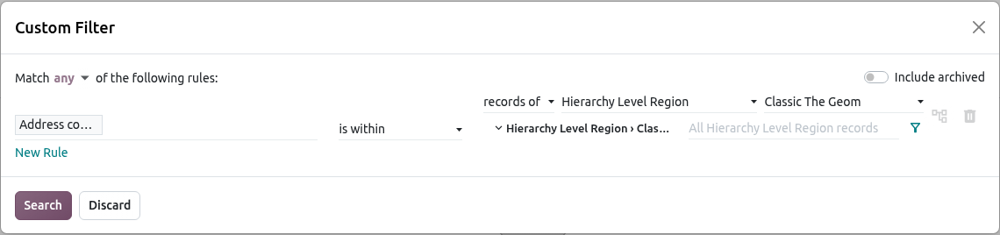
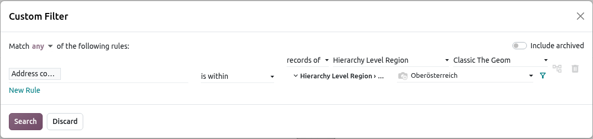
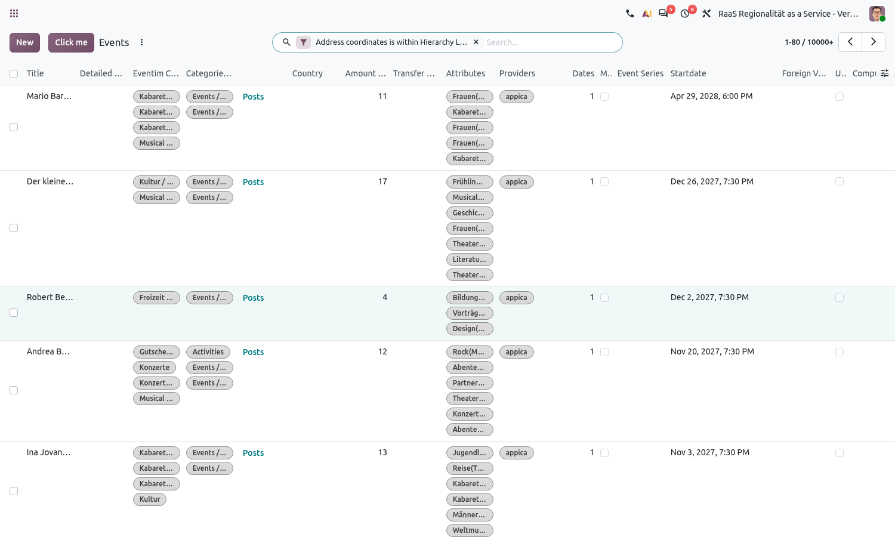

.. image:: https://odoo-community.org/readme-banner-image
   :target: https://odoo-community.org/get-involved?utm_source=readme
   :alt: Odoo Community Association

=========================
Geoengine Advanced Search
=========================

.. 
   !!!!!!!!!!!!!!!!!!!!!!!!!!!!!!!!!!!!!!!!!!!!!!!!!!!!
   !! This file is generated by oca-gen-addon-readme !!
   !! changes will be overwritten.                   !!
   !!!!!!!!!!!!!!!!!!!!!!!!!!!!!!!!!!!!!!!!!!!!!!!!!!!!
   !! source digest: sha256:58d0788ea7646dc7f2fc9e8670e7f4099df76ce28c06f564a47a26a3e523c140
   !!!!!!!!!!!!!!!!!!!!!!!!!!!!!!!!!!!!!!!!!!!!!!!!!!!!

.. |badge1| image:: https://img.shields.io/badge/maturity-Beta-yellow.png
    :target: https://odoo-community.org/page/development-status
    :alt: Beta
.. |badge2| image:: https://img.shields.io/badge/license-AGPL--3-blue.png
    :target: http://www.gnu.org/licenses/agpl-3.0-standalone.html
    :alt: License: AGPL-3
.. |badge3| image:: https://img.shields.io/badge/github-OCA%2Fgeospatial-lightgray.png?logo=github
    :target: https://github.com/OCA/geospatial/tree/20.0/geoengine_advanced_search
    :alt: OCA/geospatial
.. |badge4| image:: https://img.shields.io/badge/weblate-Translate%20me-F47D42.png
    :target: https://translation.odoo-community.org/projects/geospatial-20-0/geospatial-20-0-geoengine_advanced_search
    :alt: Translate me on Weblate
.. |badge5| image:: https://img.shields.io/badge/runboat-Try%20me-875A7B.png
    :target: https://runboat.odoo-community.org/builds?repo=OCA/geospatial&target_branch=20.0
    :alt: Try me on Runboat

|badge1| |badge2| |badge3| |badge4| |badge5|

Search geo fields inline in the search bar, with the spatial operators
of geoengine instead of the standard ones.

A condition on a geo field offers *intersects*, *is within*, *contains*,
*touches*, *is geometrically equal to*, *has a larger area than* and
*has a smaller area than* (also negated), plus *is set* / *is not set*.

The value of such a condition is either a geometry (WKT or GeoJSON), or
the records of another model picked through one of its geo fields, e.g.

``Address coordinates`` *is within* ``Contact > geom Grenzen``
``Oberösterreich``

The records can be picked directly or filtered with a sub-domain. The
search facets describe these conditions with their operator and value.

**Table of contents**

.. contents::
   :local:

Configuration
=============

Nothing to configure: the spatial operators appear in the search bar and
in every domain selector as soon as the module is installed and the
model has a geo field.

The reference models of the value selector are the models with a stored
geo field that the user can read.

Usage
=====

Open the search bar of a model with a geo field and choose *Custom
Filter*. For the field, pick the geo field (e.g. *Address coordinates*);
the operator list offers the spatial operators: *intersects*, *is
within*, *contains*, *touches*, *is geometrically equal to*, *has a
larger area than* and *has a smaller area than*, each also negated, plus
*is set* / *is not set*.

The value is either a geometry (WKT or GeoJSON), or the records of
another model picked through one of its geo fields:

1. choose *records of*, then the model and its geo field (e.g.
   *Hierarchy Level Region* / *Classic The Geom*);
2. pick the records, or filter them with a sub-domain using the funnel
   button.

|Condition on a geo field|

|Records of another model as value|

Confirm with *Search*: the facet describes the condition with the
operator and the chosen records.

|Search facet and results|

Bug Tracker
===========

Bugs are tracked on `GitHub Issues <https://github.com/OCA/geospatial/issues>`_.
In case of trouble, please check there if your issue has already been reported.
If you spotted it first, help us to smash it by providing a detailed and welcomed
`feedback <https://github.com/OCA/geospatial/issues/new?body=module:%20geoengine_advanced_search%0Aversion:%2020.0%0A%0A**Steps%20to%20reproduce**%0A-%20...%0A%0A**Current%20behavior**%0A%0A**Expected%20behavior**>`_.

Do not contact contributors directly about support or help with technical issues.

Credits
=======

Authors
-------

* Camptocamp
* ACSONE SA/NV

Contributors
------------

- `mytime.click <https://mytime.click>`__:

  - Nik

The inline geo search was part of ``base_geoengine`` before it was
extracted into this module.

Maintainers
-----------

This module is maintained by the OCA.

.. image:: https://odoo-community.org/logo.png
   :alt: Odoo Community Association
   :target: https://odoo-community.org

OCA, or the Odoo Community Association, is a nonprofit organization whose
mission is to support the collaborative development of Odoo features and
promote its widespread use.

This module is part of the `OCA/geospatial <https://github.com/OCA/geospatial/tree/20.0/geoengine_advanced_search>`_ project on GitHub.

You are welcome to contribute. To learn how please visit https://odoo-community.org/page/Contribute.
