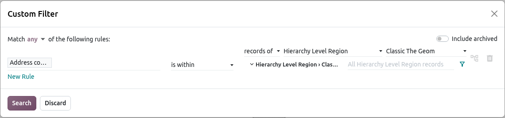
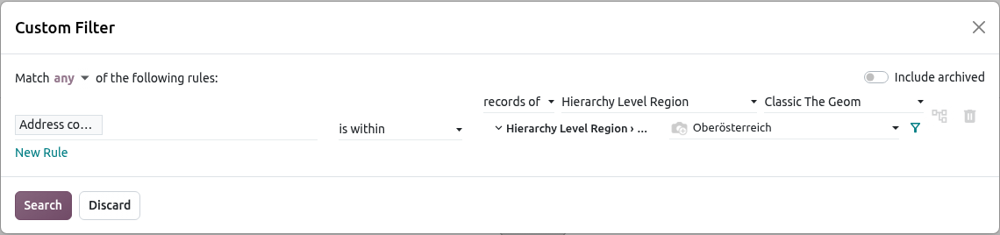
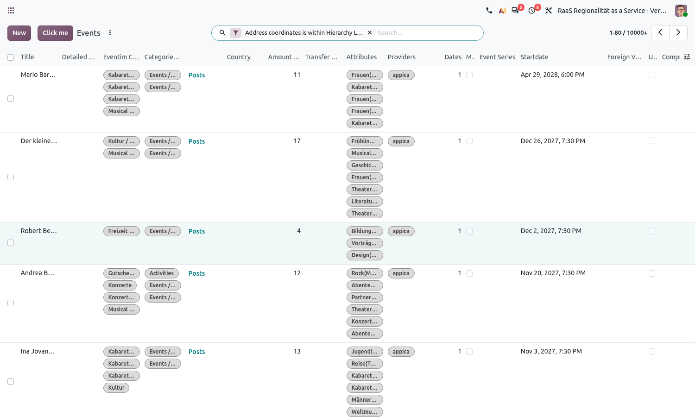

Open the search bar of a model with a geo field and choose *Custom Filter*.
For the field, pick the geo field (e.g. *Address coordinates*); the operator
list offers the spatial operators: *intersects*, *is within*, *contains*,
*touches*, *is geometrically equal to*, *has a larger area than* and *has a
smaller area than*, each also negated, plus *is set* / *is not set*.

The value is either a geometry (WKT or GeoJSON), or the records of another
model picked through one of its geo fields:

1. choose *records of*, then the model and its geo field (e.g.
   *Hierarchy Level Region* / *Classic The Geom*);
2. pick the records, or filter them with a sub-domain using the funnel button.

Confirm with *Search*: the facet describes the condition with the operator
and the chosen records.

